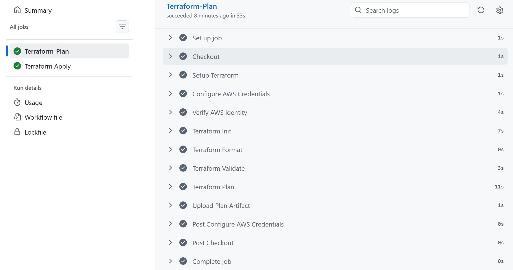
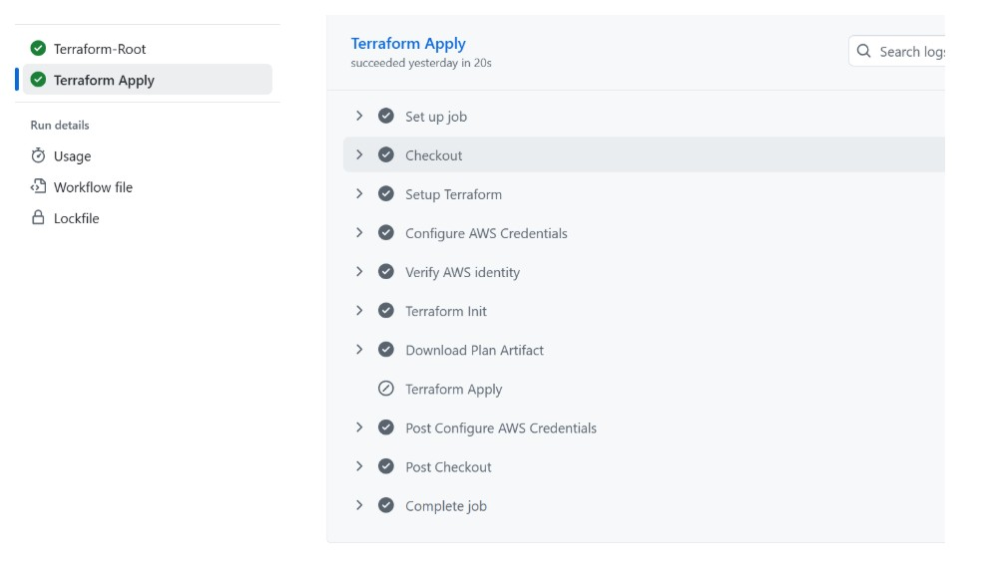
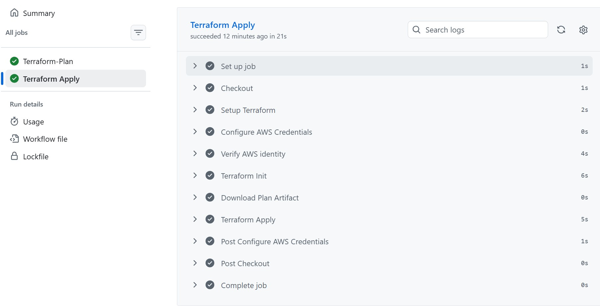
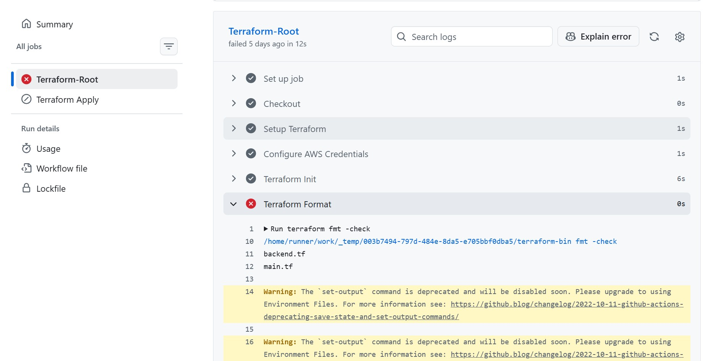
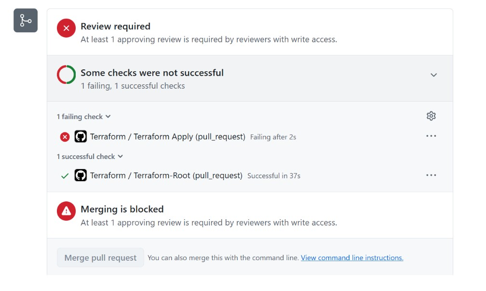
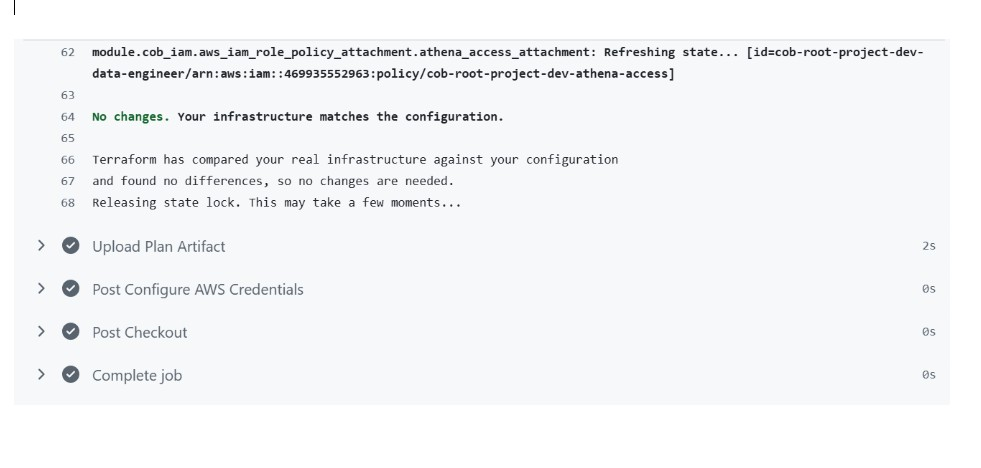

## This pipeline demonstrates workflows using real changes to COB data platform.

### - Valid infrastructure change
Add a resource or change a configuration. Open a pull request, inspect the checks and plan, merge the approved change, and demonstrate that the pipeline applies it.

 **COB Plan**

**COB Apply**

**Terraform Apply**

### - Invalid Terraform

Introduce a deliberate configuration error in a separate branch. Show that the pipeline detects the problem and prevents the deployment.

### - Repeatability

Run the workflow again when no infrastructure changes are required. Observe the resulting plan and demonstrate that your pipeline handles an unchanged environment sensibly.

